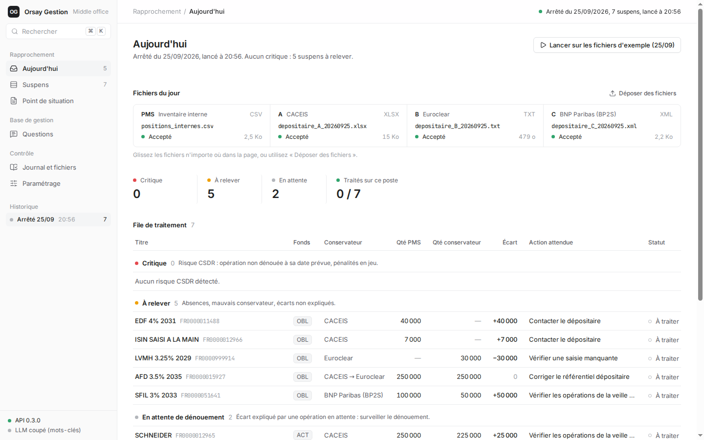
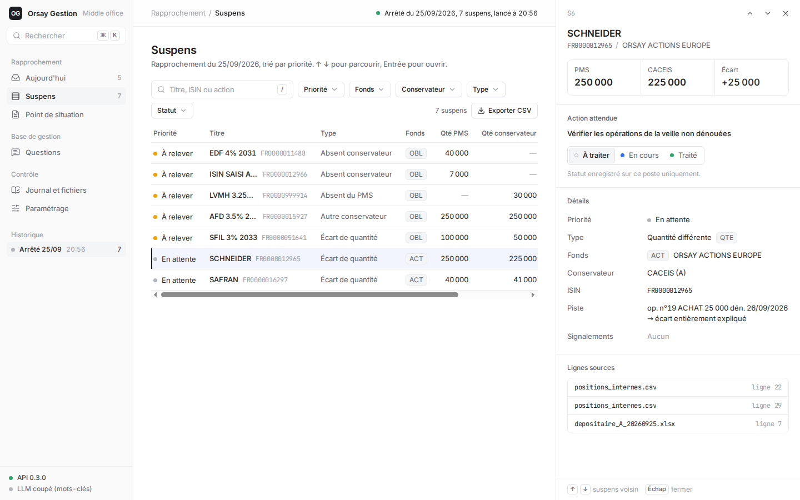
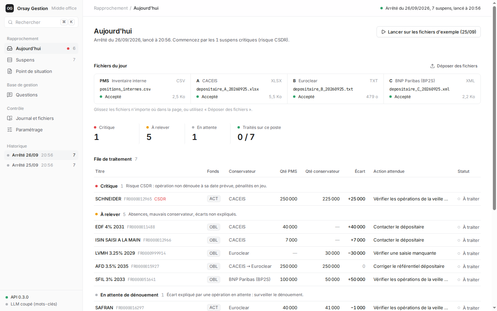
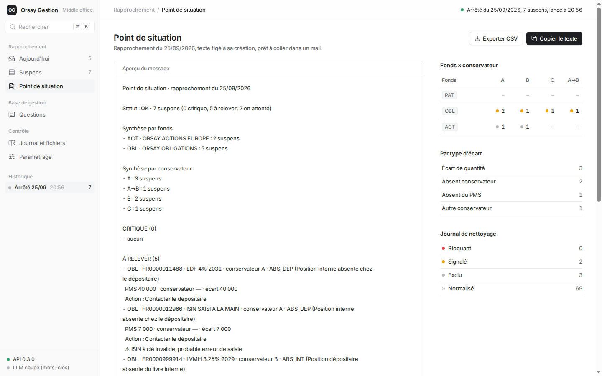
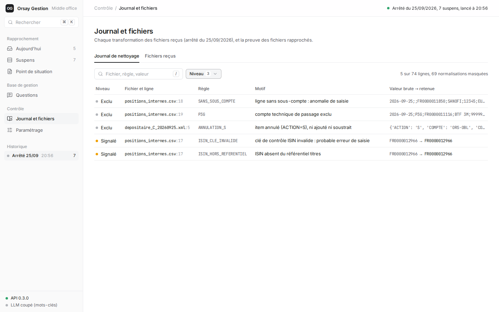
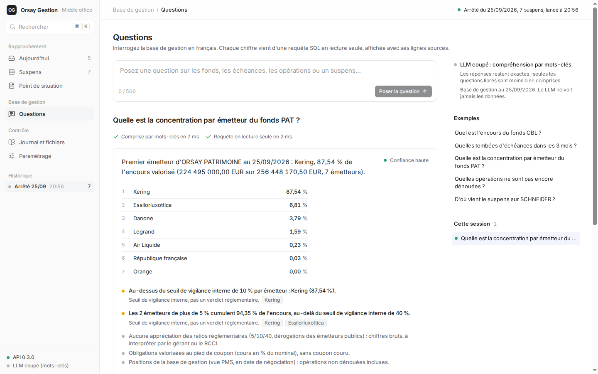
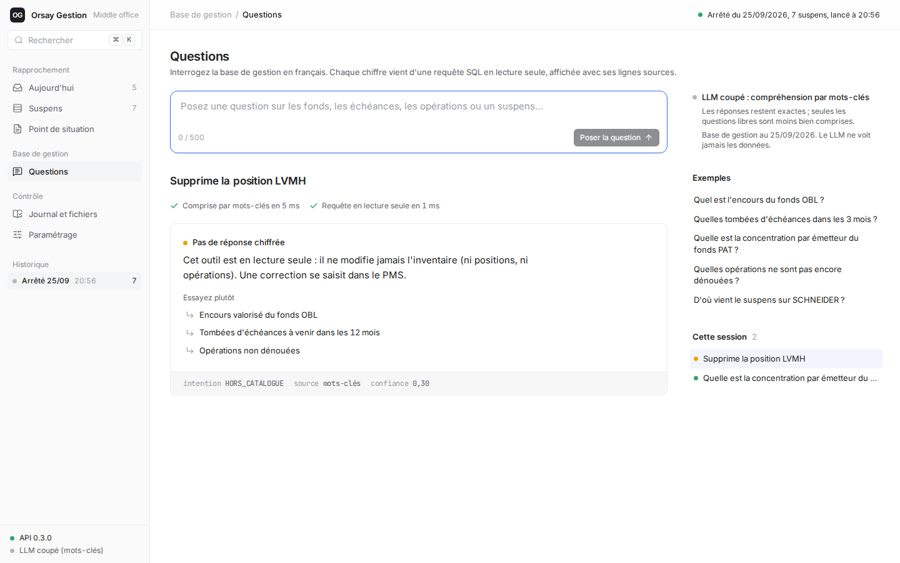

# Orsay Gestion · Middle office

**Le rapprochement quotidien des positions titres, et des réponses fiables aux gérants, sans chiffre inventé.**

Orsay Gestion est une société de gestion qui gère 3 fonds (PAT, OBL, ACT), répartis chez 3 conservateurs (CACEIS, Euroclear, BNP/BP2S). Chaque matin, un opérateur passe 1 h 30 à comparer l'inventaire interne (PMS) aux relevés des conservateurs. Un écart raté coûte des pénalités CSDR et remonte au contrôle (RCCI). Dans la journée, les gérants lui demandent l'encours, les échéances, la concentration… et il fouille la base à la main.

Cet outil fait les deux : il **rapproche en quelques secondes** et dit quoi faire pour chaque écart. Il **répond aux questions** à partir de la base, et chaque chiffre vient d'une requête SQL en lecture seule, affichée avec ses lignes sources.



---

## Démarrer en 3 commandes

Prérequis : [uv](https://docs.astral.sh/uv/). Il installe lui-même Python 3.12 et les dépendances verrouillées. Node n'est **pas** nécessaire : le front est livré déjà construit.

```bash
git clone https://github.com/Gearleur/saify.git && cd saify
make install        # ou : uv sync --locked
make run            # ou : uv run uvicorn middle_office.api:app --reload
```

Ouvrez http://127.0.0.1:8000, puis cliquez sur **« Lancer sur les fichiers d'exemple »**.

**La clé Anthropic est facultative.** Sans clé, l'outil fonctionne entièrement : les questions sont comprises par mots-clés au lieu du LLM. Pour activer le LLM : `cp .env.example .env`, puis renseignez `ANTHROPIC_API_KEY`. Le fichier `.env` est ignoré par git.

### Front et back sur deux serveurs séparés (développement)

```bash
# Terminal 1 : l'API seule
make back                      # http://127.0.0.1:8000  (autre port : make back PORT=8010)

# Terminal 2 : le front React avec rechargement à chaud (Node 20+)
make front-install             # une fois : npm ci
make front-dev                 # http://localhost:5173, /api relayé vers le back
                               # back sur un autre port ou une autre machine :
                               # make front-dev API_URL=http://127.0.0.1:8010
```

Après une modification du front : `make front-build`, qui reconstruit `middle_office/web/` (à commiter).

### Toutes les commandes

| Commande | Rôle |
|---|---|
| `make install` | Python 3.12 et dépendances exactes (`uv.lock`) |
| `make run` | application complète (API + front construit) sur `:8000` |
| `make back` / `make front-dev` | les deux serveurs séparés, pour développer |
| `make cli` | rapprochement du 25/09 en ligne de commande |
| `make check` | lint, format et 186 tests (sans réseau ni LLM) |
| `make front-check` / `make front-build` | lint et typage du front / build dans `middle_office/web/` |

---

## Ce que fait l'outil

### Besoin 1 : le rapprochement du matin

**8 h : déposer les fichiers.** Les 4 fichiers du jour (PMS en CSV, CACEIS en Excel, Euroclear en largeur fixe, BNP en XML) sont lus et nettoyés. Chaque transformation est tracée dans un **journal** à 4 niveaux :

| Niveau | Sens | Exemple réel du 25/09 |
|---|---|---|
| `NORMALISE` | forme corrigée, sens inchangé | ` fr0000014078 ` → `FR0000014078` ; `"10 000"` → 10000 ; 2 décimales implicites |
| `EXCLU` | ligne retirée selon une règle du client | sous-compte technique P3G ; ligne sans sous-compte ; lot annulé chez BNP |
| `SIGNALE` | ligne conservée mais douteuse | ISIN à la clé de contrôle invalide |
| `BLOQUANT` | fichier refusé, **avec le remède** | mauvaise date, total de contrôle faux, compte inconnu de la transco |

Une seule anomalie bloquante, et **aucun suspens n'est produit**. Un rapprochement partiel cacherait des écarts : c'est le pire risque pour le client.

**8 h 05 : traiter par priorité.** Les suspens arrivent à la maille fonds × ISIN × conservateur, avec leur type (`QTE`, `ABS_DEP`, `ABS_INT`, `DEP`) et l'action attendue lue dans le paramétrage du client :
- **Critique** : une opération aurait dû être dénouée et ne l'est pas (risque CSDR) ;
- **À relever** : titre absent, mauvais conservateur, écart inexpliqué ;
- **En attente** : écart **entièrement expliqué**, avec un calcul signé, par une opération en cours (« op. n°19 ACHAT 25 000, dén. 26/09 »).



Chaque suspens est traçable jusqu'à la ligne du fichier d'origine. Le statut de traitement (à traiter, en cours, traité) est gardé sur le poste.

**Le lendemain matin.** La date d'arrêté est lue dans les fichiers, jamais codée en dur. Avec les mêmes fichiers datés du 26/09, l'achat SCHNEIDER aurait dû se dénouer et ne l'est toujours pas : il passe **en critique**.



**10 h : le point de situation.** Un texte prêt à coller dans un mail pour le responsable, l'export CSV, et la matrice fonds × conservateur.

| Point de situation | Journal de nettoyage |
|---|---|
|  |  |

### Besoin 2 : les questions des gérants et du RCCI

« Encours du fonds obligataire ? », « Qu'est-ce qui arrive à maturité d'ici la fin de l'année ? », « Concentration par émetteur de PAT ? », « Opérations non dénouées ? », « D'où vient le suspens sur SCHNEIDER ? »



Le fonctionnement, conçu pour qu'**aucun chiffre ne puisse être inventé** :

```
question ─► LLM (Claude Haiku 5.5) ─► intention typée, validée par pydantic
             │  ne reçoit que la question et la date, jamais les données
             │  panne, clé absente ou refus : repli par mots-clés (raison tracée)
             ▼
            catalogue de requêtes SQL fixes, base en lecture seule, calculs en Decimal
             ▼
            phrase issue d'un gabarit + chiffres + requête exacte + lignes sources
```

- **Le LLM classe la question, il ne répond pas.** Il choisit une entrée du catalogue et ses paramètres. Les chiffres viennent du SQL, la phrase vient d'un gabarit.
- **Lecture seule garantie par 3 verrous** : fichier ouvert en `mode=ro`, `PRAGMA query_only`, et un autorisateur SQLite qui refuse toute opération autre qu'une lecture. « Personne ne doit pouvoir modifier l'inventaire » : c'est testé.
- **Sous le seuil de confiance, aucune réponse chiffrée** : l'outil affiche « Attention » et propose 2 ou 3 reformulations, revérifiées contre le catalogue. C'est le cas aussi pour une demande hors catalogue ou d'écriture.
- **Règles de vigilance** : des seuils internes simples (un émetteur au-delà de 10 % ; les émetteurs au-delà de 5 % cumulant plus de 40 %), modifiables, et **jamais présentés comme un verdict réglementaire**.
- **Usage de la clé encadré** : modèle imposé, budget de 300 appels par jour, 4 appels simultanés au maximum, timeout, cache des questions identiques, rate limit dédié, consommation journalisée. La clé n'est jamais renvoyée ni écrite dans les logs.



---

## Architecture

```
middle_office/
├── domaine/                  métier pur, sans HTTP ni framework
│   ├── rapprochement/        besoin 1 : sources.py (4 lecteurs + journal), moteur.py, situation.py
│   └── questions/            besoin 2 : base.py (lecture seule), catalogue.py, vigilance.py, comprehension.py
├── api/                      FastAPI (contrat : docs/API.md)
│   ├── routes/               systeme · rapprochements · questions (JSON et flux SSE) · web
│   ├── services/             dépôt, exécution, historique SQLite, référentiel, encadrement du LLM
│   ├── middleware.py         request id, rate limit, taille des requêtes, en-têtes de sécurité, logs
│   └── config.py · schemas.py · erreurs.py · limiteur.py · dependances.py · app.py
└── web/                      build du front (généré)
front/src/                    React + TypeScript + Tailwind + shadcn/ui (architecture : docs/FRONT.md)
├── types/ · lib/api/         contrat d'API typé, client HTTP et SSE, formatage décimal sans float
├── components/ · components/ui/   composants partagés, primitives shadcn
├── features/                 triage · files · suspens · situation · journal · questions · settings
└── app/                      coquille, barre latérale, routes, palette ⌘K
tests/                        186 tests Python, oracles calculés à la main
```

Le domaine ne sait rien du HTTP, et l'API ne connaît aucun format de fichier : ajouter un quatrième conservateur, c'est écrire un lecteur. Sécurité : CSP stricte (`script-src 'self'`, sans `unsafe-inline`), en-têtes de sécurité, erreurs sans trace interne, validation de chaque entrée, refus des XML piégés (`DOCTYPE`/`ENTITY`).

## Les choix, et pourquoi

| Choix | Plutôt que | Parce que |
|---|---|---|
| Rapprochement **déterministe**, en Python | un LLM | la règle est exacte, sans tolérance ; un LLM n'ajoute qu'un risque de suspens raté ([ADR 0001](docs/adr/0001-moteur-deterministe-front-html.md)) |
| `Decimal` partout, quantités en **texte** dans le JSON | `float` | pas d'arrondi binaire sur des positions ; le front formate sans `parseFloat` |
| Blocage **total** si un fichier est refusé, avec remède | rapprocher les fichiers sains | un fichier conservateur manquant produirait de faux « absents » en masse |
| Un seul suspens `DEP` (avec l'écart) quand un titre est chez un autre conservateur | `DEP` + `QTE` | l'énoncé : « un seul suspens, pas deux » |
| `orsay.db` facultative pour le rapprochement | la base comme clé | l'énoncé : elle informe, elle ne décide pas ; sans elle, les suspens sortent quand même |
| Questions par **catalogue** + LLM classifieur | du text-to-SQL | un chiffre faux (×1 000 sur le nominal, mauvaise jointure) serait un incident RCCI |
| React + shadcn, **build commité** | HTML natif / Next.js | finition et composants ; une seule commande pour la démo, sans Node ([ADR 0002](docs/adr/0002-front-react-shadcn.md)) |

Les décisions détaillées et les alternatives écartées sont dans [`NOTES.md`](NOTES.md), le vocabulaire métier dans [`CONTEXT.md`](CONTEXT.md).

## Ce qui est vérifié, et ce qui ne l'est pas

**Vérifié, avec la sortie vue :**
- **Les 7 suspens du 25/09** égalent un oracle calculé à la main, et les encours aussi (OBL 724 836,00 €, ACT 167 647 000,00 €, PAT 256 448 170,50 €).
- **186 tests** : un par piège des données, un par règle métier, et l'API (erreurs, 413, 422, 429, SSE, lecture seule, secret jamais exposé). La CI les rejoue sans réseau.
- **Clone neuf sans `.env`** : installation, tests verts, serveur et front fonctionnels.
- **Essai réel avec Claude Haiku 5.5**, sur des questions formulées librement. Il a révélé 4 défauts invisibles aux tests (horizon « fin d'année », refus d'écriture, hors catalogue, reformulations inventées), tous corrigés.
- **Front** : typage strict, lint sans avertissement, zéro violation CSP sur le parcours complet, navigation au clavier.

**Non vérifié :**
- La CI GitHub n'a pas encore tourné.
- Aucun test de composants React.
- Le glisser-déposer à la vraie souris.
- La clé API a été révoquée après la session (401), comme prévu par l'énoncé : le chemin LLM est désormais vérifié par des faux clients, et le repli par mots-clés en conditions réelles.

## Limites connues

- **Processus unique** : le rate limit et le budget LLM vivent en mémoire, l'historique dans un SQLite local (`var/`, hors git) sans rétention définie. Pour la production : Redis, ou une base partagée, et une durée de conservation fixée avec le RCCI.
- **Le seuil de confiance (0,7) repose sur la confiance que le LLM s'attribue**, un signal faible. Il faudrait le calibrer sur un jeu de vraies questions de gérants.
- **Unités** : on suppose les obligations en nominal partout. Un conservateur qui enverrait un nombre de titres produirait de faux écarts.
- **Un titre trouvé dans un autre fonds** (erreur de transco probable) donne deux suspens, non fusionnés.
- **Remèdes et horizon des échéances (12 mois)** : rédigés et choisis par nous, à valider avec le middle office.
- **Le domaine importe le SDK Anthropic** : une interface « classifieur » le rendrait indépendant du fournisseur.

---

## Si personne n'avait relu le code, ni recadré

Ce projet a été construit avec Claude Code, étape par étape. Chaque étape passait par une revue humaine qui **challengeait les choix**, et pas seulement le résultat. Tout ce qui suit est réellement arrivé pendant la construction : l'historique git et [`NOTES.md`](NOTES.md) en gardent la trace.

**Ce que la première version, « qui marchait », contenait :**

| Sans relecture | Conséquence pour le client | Ce qu'a apporté la relecture |
|---|---|---|
| Les lignes à moitié vides d'un relevé étaient **ignorées sans trace** | des **faux négatifs invisibles**, le pire cas (pénalités CSDR) | BLOQUANT `LIGNE_INCOMPLETE` : une donnée n'apparaît ni ne disparaît sans trace |
| `"10.000"` était lu **10**, sans alerte | un faux écart, ou un vrai écart mal chiffré | contrôle sur le **texte brut**. Le test a montré que ma première idée (« quantité non entière ») ne protégeait rien, puisque `Decimal("10.000")` est entier |
| Une piste « op. n°19 » affichée à côté de **n'importe quel** écart | l'opérateur classe un suspens que l'opération n'explique pas | calcul signé : entièrement, partiellement ou pas du tout expliqué |
| La priorité déduite en **cherchant des mots** dans les messages | reformuler un message déclasse un critique en silence | champs structurés (`explication`, `alertes`) |
| La date d'arrêté **codée en dur** (25/09) | inutilisable le lendemain matin | date lue dans les fichiers ; le scénario du 26/09 fait apparaître le CSDR |
| `orsay.db` utilisée comme **clé** du rapprochement | contraire à l'énoncé ; base absente = plus de contrôle | base facultative, clé fonds tirée du paramétrage |
| Une seule anomalie de paramétrage faisait **planter** l'outil, ou « le dernier fonds lu gagnait » | un résultat faux sans erreur | BLOQUANT `PARAMETRAGE` avec le remède |
| Le LLM sans date de référence ; un « supprime la position » répondu par « pas compris » | une réponse sur le mauvais horizon ; un refus incompréhensible | trouvé par un **essai réel**, corrigé et verrouillé par des tests |

**Ce que la base de code aurait été :**
- **Une API en un fichier de 650 lignes** qui mêlait configuration, sécurité, schémas et routes. Elle a été découpée en couches (`domaine` / `api` / `web`), sans changer un seul comportement : les 95 tests de l'époque étaient le filet.
- **Un front HTML de 1 700 lignes dans un seul fichier**, à la finition « générée » : des pastilles colorées partout, si bien que la couleur ne signalait plus rien. Il a été refait en React avec shadcn, en composants de moins de 150 lignes, dans le style d'Attio : la couleur n'apparaît que là où elle porte une information.
- **Un dépôt encombré** : un `test.py` « Hello world », des CSV générés commités, des dépendances jamais utilisées (LangGraph, pdfplumber, rapidfuzz…), un paquet nommé `reco` alors qu'il portait aussi le besoin 2.
- **Des étapes enchaînées sans validation.** L'agent avait déjà commité l'étape 2 et commencé la 3 quand il a été arrêté : « on fait étape par étape, je veux comprendre pourquoi on implémente ça ». Chaque étape s'est ensuite terminée par une revue avec des questions précises.

Sans ces recadrages, l'outil aurait passé ses propres tests et donné les 7 bons suspens sur les données du 25/09. Mais il aurait été **fragile précisément là où le client a peur** : des écarts perdus en silence, des chiffres mal lus, des priorités qui se dérèglent au moindre changement de texte. Le code aurait aussi été difficile à reprendre. Les tests vérifient ce qu'on a pensé à écrire ; la relecture sert à trouver ce qu'on n'avait pas pensé à tester.

---

## Documentation

- [`docs/API.md`](docs/API.md) : le contrat d'API (routes, erreurs, garde-fous, flux SSE)
- [`docs/FRONT.md`](docs/FRONT.md) : les choix d'agencement vue par vue, et l'architecture du front
- [`docs/adr/`](docs/adr/) : les décisions d'architecture
- [`NOTES.md`](NOTES.md) : le journal des choix, dans l'ordre, avec les alternatives écartées
- [`CONTEXT.md`](CONTEXT.md) : le glossaire métier (middle office, suspens, CSDR…)
- [`docs/CONSIGNE.md`](docs/CONSIGNE.md) : l'énoncé du cas · [`docs/sessions/`](docs/sessions/) : les exports des sessions Claude Code
- [`exploration/`](exploration/) : l'analyse exploratoire des données (notebook)

Les données de `data/donnees/` sont celles du cas (fictives).
